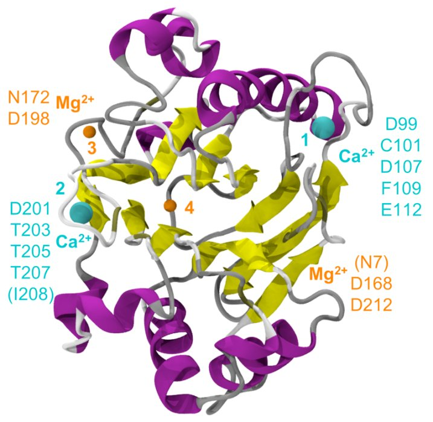

# BioSpring

**Domaine** : simulation moléculaire interactive · **Collaboration** : LBT (Marc Baaden, Benoist Laurent…)

<figure markdown>

<figcaption>Localisation interactive de sites de liaison ionique sur une protéine.</figcaption>
</figure>

## Résumé

BioSpring représente une macromolécule comme un réseau de particules reliées par
des ressorts, à l'échelle tout-atome, gros-grain ou carbones α. Ce réseau élastique
est « augmenté » de termes supplémentaires : électrostatique, ajustement à une
densité de cryo-microscopie ou de SAXS, agrégation, et forces externes pour la
manipulation interactive.

Le moteur de calcul communique avec la visualisation (typiquement UnityMol) et les
périphériques haptiques via MDDriver. On peut ainsi explorer la mécanique d'une
protéine, faire du docking ou positionner des protéines dans une membrane, en
modifiant les paramètres sans interrompre la simulation, sur un poste standard.

**Publication** : *BioSpring: an elastic network framework for interactive
exploration of macromolecular mechanics*, Protein Science, 2025 — voir
[Publications](../publications.md).
