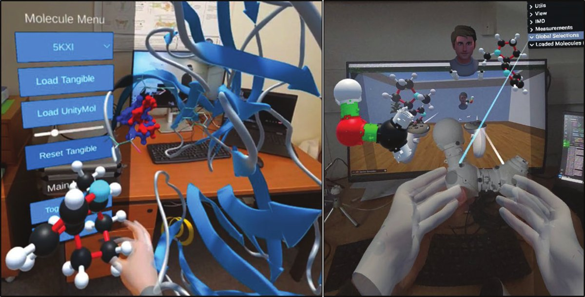

# UnityMol / UnityMol-Lite

**Domaine** : visualisation moléculaire 3D · **Collaboration** : LBT (Marc Baaden)

<figure markdown>

<figcaption>UnityMol-Lite : manipulation de molécules en réalité étendue.</figcaption>
</figure>

## Résumé

UnityMol est un environnement de visualisation et d'interaction 3D pour la biologie
moléculaire, utilisé aussi bien sur poste de travail qu'en réalité virtuelle. J'ai
contribué à sa spécification et à sa pérennisation, notamment dans le cadre du
projet [UCB BioPharma](../projets/ucb-biopharma.md), et il sert de front-end à
[BioSpring](biospring.md).

**UnityMol-Lite** (2024) le rend accessible sur des plateformes variées et permet à
plusieurs chercheurs de collaborer à distance en réalité étendue sur une même
scène moléculaire (EuroXR 2024).
