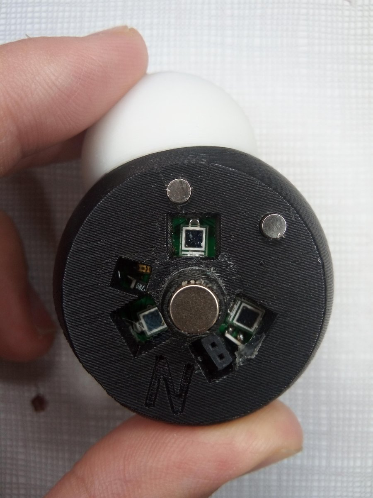

# BioTIN'INT

**Rôle** : co-porteur · **Financement** : Institut Farman · **Période** : 2016 – 2020

<figure markdown>

<figcaption>Manipulation de la maquette instrumentée : la conformation de l'objet physique est reproduite en temps réel à l'écran (Vincke et al., 2019).</figcaption>
</figure>

## Résumé

BioTIN'INT a conçu une interface moléculaire tangible : une maquette physique qui
dialogue avec sa contrepartie virtuelle, pour cumuler la prise en main d'un objet
réel et la puissance de la simulation. Le projet, mené avec Bastien Vincke (SATIE),
s'appuie sur deux approches complémentaires.

- **Suivi sans marqueur** (thèse de Xavier Martinez) : la conformation d'une
  maquette modulaire (Peppytide) est reconstruite à partir d'une simple vidéo RGB,
  avec une estimation de son énergie.
- **Maquette instrumentée** (internet des objets) : des atomes imprimés en 3D,
  assemblés par aimants, embarquent chacun un capteur d'orientation sans fil. La
  conformation est capturée en temps réel et transmise au moteur de simulation
  interactive.

Une étude utilisateur a montré un gain mesurable face à une interface graphique de
bureau pour une tâche de modélisation moléculaire. Ces travaux se poursuivent dans
le projet [ANR PIRATE](pirate.md).
