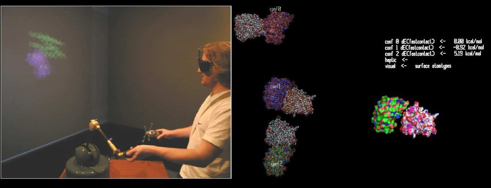

# ANR CoRSAIRe

**Rôle** : participant · **Financement** : ANR

<figure markdown>

<figcaption>Docking de protéines en environnement immersif avec bras haptique et rendus visuel et sonore (Férey et al., 2009).</figcaption>
</figure>

## Résumé

CoRSAIRe partait de l'hypothèse que la réalité virtuelle et l'interaction
multimodale pouvaient faciliter le docking protéine-protéine, une tâche où il faut
piloter simultanément de nombreux degrés de liberté. Une analyse ergonomique des
pratiques des biologistes a précédé la conception d'une application immersive
combinant rendu stéréoscopique, retour haptique et retour sonore, coordonnés par un
superviseur multimodal.

Le projet a montré que la performance et la confiance dans le résultat dépendent
moins de la précision du geste que de la cohérence entre les canaux sensoriels et
la nature du problème biologique. Ce résultat a orienté mes travaux ultérieurs sur
l'interaction multisensorielle et la simulation moléculaire interactive.

**Publications** : *Multisensory VR interaction for protein-docking in the CoRSAIRe
project*, Virtual Reality, 2009 ; *Docking de protéines en réalité virtuelle : une
approche hybride et multimodale*, TSI, 2009 — voir [Publications](../publications.md).
