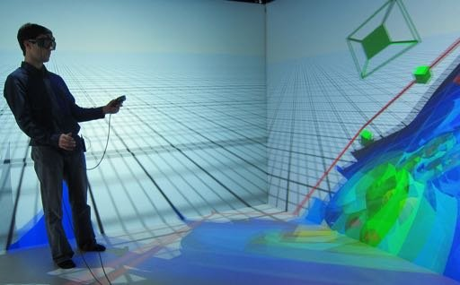

# EquipEx Digiscope

**Rôle** : participant · **Période** : depuis 2012

<figure markdown>

<figcaption>Exploration immersive de données de mécanique des fluides en CAVE (Chen et al., 2015).</figcaption>
</figure>

## Résumé

Digiscope est un équipement d'excellence regroupant des plateformes de
visualisation et d'interaction sur le plateau de Saclay. J'y porte des applications
de biologie moléculaire vers les environnements immersifs et les murs d'écrans à
haute résolution.
