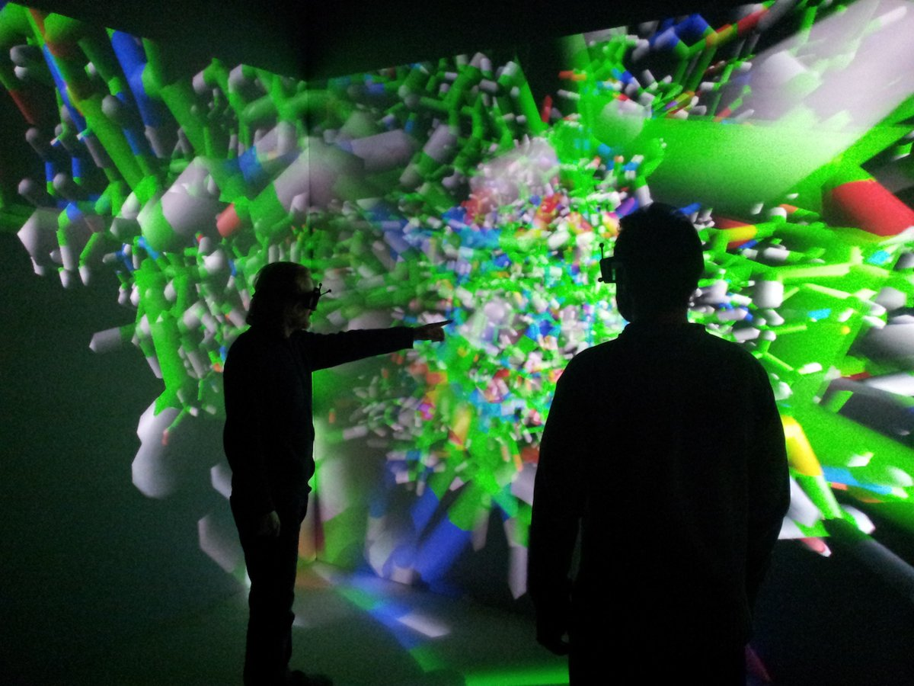

# ANR ExaViz

**Rôle** : partenaire, responsable de lot · **Période** : 2011 – 2015

<figure markdown>

<figcaption>Deux experts explorent en CAVE, à l'échelle 1, une simulation de dynamique moléculaire de grande taille.</figcaption>
</figure>

## Résumé

ExaViz traitait de la visualisation, de la simulation haute performance et de la
navigation dans des données massives, à l'échelle exascale. Le cadre logiciel
développé couple la simulation de dynamique moléculaire à des outils d'analyse et
de pilotage placés au plus près du calcul : on évite d'écrire sur disque des
résultats volumineux et le scientifique agit sur la simulation pendant qu'elle
tourne, y compris en CAVE, à l'échelle 1 et à plusieurs.
