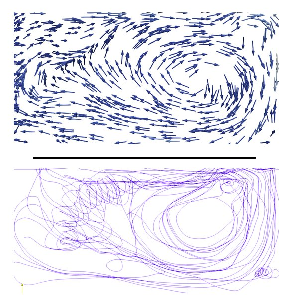

# FluidMeAT

**Rôle** : porteur · **Financement** : Center for Data Science (IDEX Paris-Saclay) · **Période** : 2014 – 2015

<figure markdown>

<figcaption>Champ de vitesses et lignes de courant d'une simulation de fluide.</figcaption>
</figure>

## Résumé

FluidMeAT portait sur l'annotation de corpus de données de mécanique des fluides 2D
et 3D, afin de produire des données exploitables par l'apprentissage
semi-supervisé. Il s'inscrit dans mes travaux sur l'exploration interactive de
simulations de fluides, poursuivis ensuite par la thèse de Mengchen Wang sur la
simulation interactive asynchrone.
