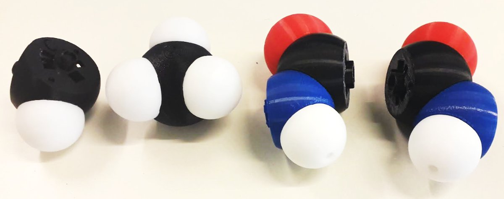

# ANR PIRATE

**Rôle** : partenaire · **Porteur** : Antoine Taly (LBT) · **Période** : depuis 2021

<figure markdown>

<figcaption>Atomes modulaires imprimés en 3D, assemblables par aimants selon les géométries de liaison.</figcaption>
</figure>

## Résumé

PIRATE vise à concevoir et évaluer une plateforme qui combine réalité augmentée et
interface moléculaire tangible pour la conception rationnelle de médicaments.
L'utilisateur manipule physiquement une maquette de molécule tout en voyant,
superposées, les informations structurales et énergétiques associées.

Le projet associe le LBT, CiTCoM (Samuela Pasquali), ITODYS (Florent Barbault),
SATIE (Bastien Vincke) et le LISN. J'y ai encadré le post-doctorat de Mariano Spivak
(2023–2024), consacré au pilotage d'une simulation moléculaire en cours avec
l'interface tangible, en vue du docking de ligands flexibles.

**Voir aussi** : [BioTIN'INT](biotinint.md), [UnityMol-Lite](../logiciels/unitymol.md).
