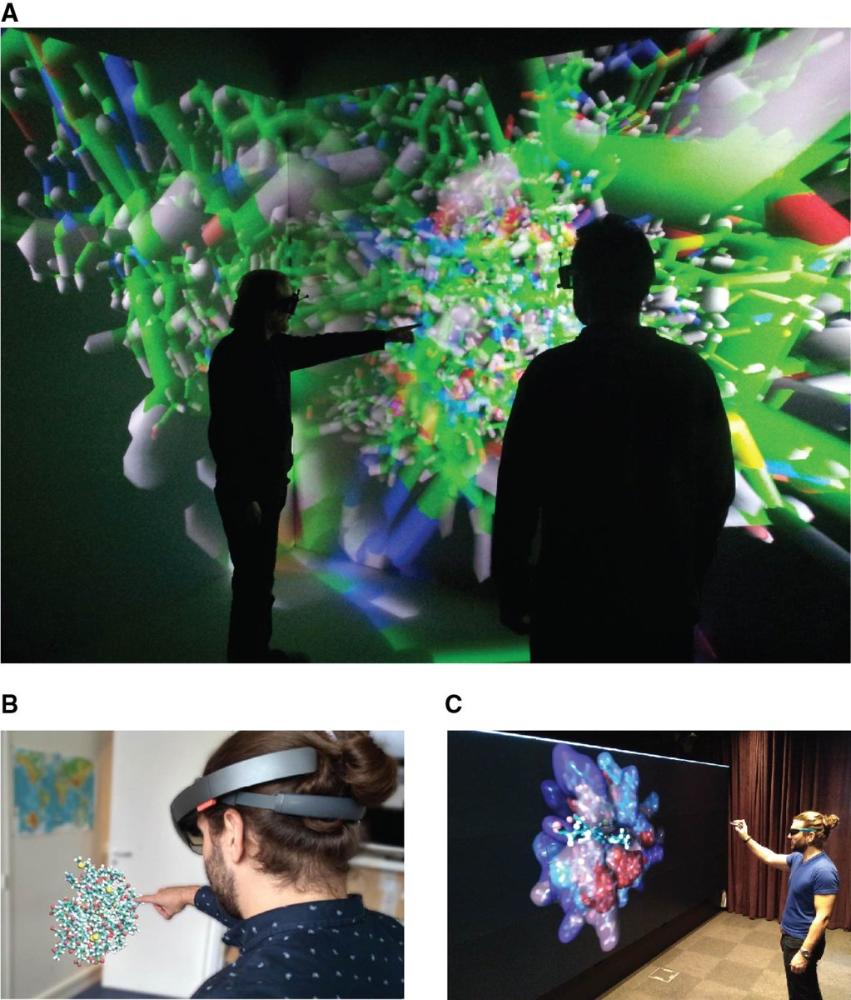

# UCB BioPharma

**Rôle** : partenaire · **Type** : projet de R&D industriel · **Période** : 2017 – 2019

<figure markdown>

<figcaption>UnityMol en environnement immersif, en réalité augmentée et sur mur d'écrans (Trellet et al., 2018).</figcaption>
</figure>

## Résumé

Projet mené avec le Laboratoire de Biochimie Théorique (Marc Baaden) pour spécifier
et pérenniser UnityMol, l'environnement de visualisation et d'interaction 3D pour la
biologie moléculaire, en vue de son usage dans un contexte industriel.

**Voir aussi** : [UnityMol](../logiciels/unitymol.md).
